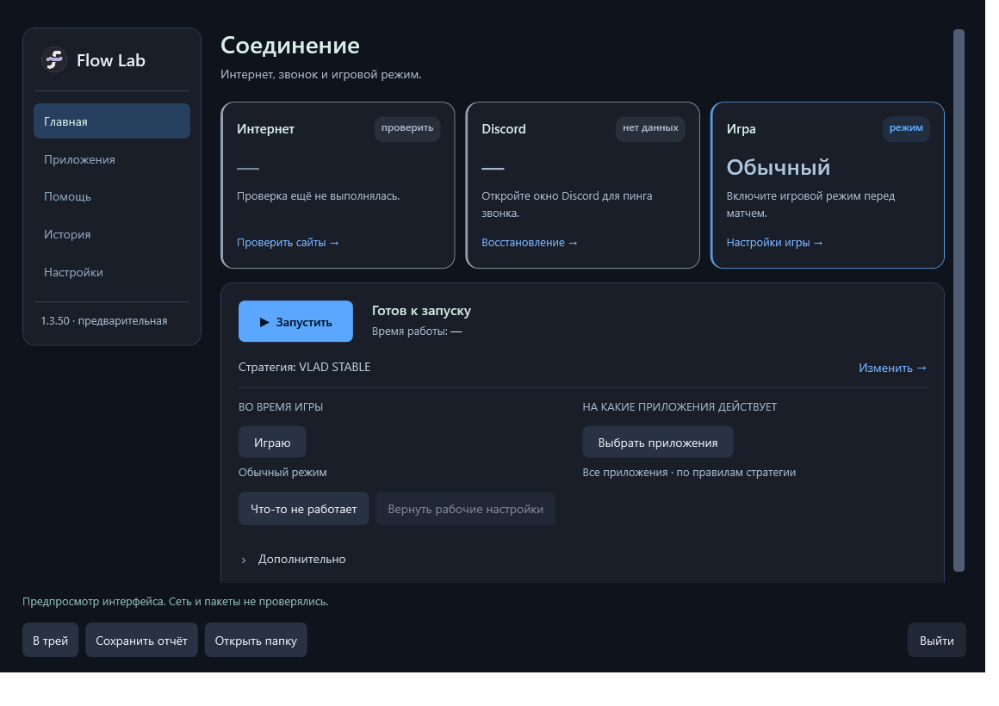

# Flow Lab

**Своя рабочая стратегия — в понятном приложении для Windows.**

Flow Lab объединяет zapret / zapret2, исключения приложений, Telegram-прокси и инструменты для диагностики Discord. Можно сохранить рабочие настройки, проверить другой вариант и вернуться обратно.

### Скачать 1.3.50 · предварительная версия

**[Скачать установщик](https://github.com/krizof/flow-lab/releases/download/v1.3.50-preview/Flow-Lab-Setup.exe)** · [Короткая инструкция](START-HERE.txt) · [Что изменилось](https://github.com/krizof/flow-lab/releases/tag/v1.3.50-preview)

Windows 10/11 x64 · .NET Framework 4.8 · Python не нужен. Установщик создаёт постоянную папку программы и ярлык в меню «Пуск».

[Переносной EXE](https://github.com/krizof/flow-lab/releases/download/v1.3.50-preview/Flow-Lab.exe) · [Все выпуски](https://github.com/krizof/flow-lab/releases)

*Предпросмотр интерфейса. Пустые показатели означают, что замер ещё не выполнен; цифры пинга не придумываются.*

## Что умеет

| Возможность | Для чего |
| --- | --- |
| Мастер первого запуска | Выбрать прежнюю папку и стратегию. Подготовить отдельную копию пакета. |
| zapret и zapret2 | Выбирать движок, устанавливать пакет, просматривать обновление и возвращать прежнюю конфигурацию. |
| Приложения и исключения | Указывать, на какие EXE распространяются правила. Исключать игру, браузер или другую программу. |
| Сети и рабочие копии | Хранить разные настройки для сетей и возвращаться к сохранённому варианту. |
| Проверки и подбор | Проверять выбранные сервисы и свои сайты; сравнивать варианты с исходным. Результат применяется отдельной кнопкой. |
| Discord | Раздельно оценивать голос и демонстрации, сохранять историю и пробовать ограниченное восстановление известных отказов. |
| CS2/FACEIT | Включать TCP + UDP и IPSet any, приостанавливать новые попытки восстановления на время игры и возвращать настройки. |
| Telegram | Управлять встроенным локальным прокси без отдельного окна tg-ws-proxy. |
| Обновления и отчёты | Проверять выпуски GitHub, устанавливать обновление по кнопке и сохранять диагностический ZIP. |

## Начать пользоваться

1. Остановите обычный zapret, включая службу, если она установлена, и выйдите из старой Flow Lab. Папку рабочего zapret сохраните.
2. Установите **Flow-Lab-Setup.exe** и откройте Flow Lab.
3. В мастере нажмите **«Выбрать папку zapret»**. Для обычного zapret выберите папку с `service.bat`, `bin` и `lists`.
4. Выберите **ту же стратегию**, которой уже пользовались. Нажмите **«Подготовить настройки»**, затем **«Запустить»**. Подтвердите запрос администратора для сетевого исполнителя.
5. Проверьте нужные сервисы, голос и демонстрации в обе стороны. При первом запуске не меняйте рабочий BAT ради чужой рекомендации.

Если мастер не появился: **Настройки → Открыть мастер настройки**. Отдельный BAT одновременно с управляемым Flow Lab zapret запускать не нужно.

**VLAD STABLE и TTL4 — стратегии, а восстановление Discord — отдельная функция.** Успех этих стратегий в одной сети не делает их универсальными.

## Если что-то не работает

Нажмите **«Сохранить отчёт»** внизу окна, дождитесь готовности и откройте папку. Вместе с ZIP сообщите:

- что именно не работает: запуск Discord, голос, просмотр или отправка демонстрации, сайт или игра;
- примерное время и часовой пояс;
- выбранную стратегию и состояние VPN.

Журналы никуда не отправляются автоматически. Отчёт может содержать сетевые адреса и локальные пути — передавайте его лично, а перед публичным размещением проверьте содержимое. Разговоры не записываются.

## Обновление через GitHub

**Настройки → Обновления Flow Lab → Канал обновлений → Тестовые версии (preview) → Проверить сейчас.**

При появлении более новой версии станет доступна кнопка **«Обновить и перезапустить»**. Пункт **«Проверять при открытии и каждые 6 часов»** включает автоматическую проверку; установка остаётся вашим действием.

Проверяются подпись описания обновления, размер и SHA256 EXE. Настройки сохраняются; если новая версия не подтвердит запуск, предусмотрена попытка возврата прежнего EXE. Обновляйте после звонка или матча: управляемые сетевые функции ненадолго перезапускаются.

Канал **«Стабильные версии»** не предлагает предварительные выпуски. Возврат к нему не понижает установленную версию: программа ждёт более новый стабильный выпуск.

## Что исправлено в 1.3.50

- В сравнении стратегий участвует время ответа добавленных пользователем сайтов.
- Периодические запросы к сетевому исполнителю выполняются в фоне.
- Исправлена очистка внутренних копий при выбранном удалении пользовательских данных.
- Добавлено хранение журналов: 14 дней и общий бюджет 512 МБ. Активные записи и готовые архивы сохраняются.
- Уточнены подписи области действия правил и результатов проверки.

## Проверки и ограничения

**Пройдены 50 наборов проверок программы и 23 проверки установщика.** [Результаты и границы проверки](QA-1.3.50.txt).

Выпуск предназначен для первоначальной обкатки. Проверки кода не подтверждают работу у любого провайдера, в конкретном матче FACEIT или после нескольких суток использования. У итоговой 1.3.50 ещё остаются отдельные проверки настоящего звонка, драйвера, входа в Windows с автозапуском и длительной работы.

Ответ сервера и появление пакетов сами по себе не доказывают слышимый голос или видимую демонстрацию. Восстановление ограничено известными признаками сбоев; дополнительные медиарежимы экспериментальные. Игровые исключения не гарантируют совместимость драйвера с античитом. Flow Lab не предоставляет собственную сеть VPN-серверов и не обещает снизить пинг.

EXE пока не имеет подписи Windows Authenticode. Это отдельно от подписи описания обновлений, которую приложение проверяет встроенным ключом.

## Основа проекта

[Flowseal/zapret-discord-youtube](https://github.com/Flowseal/zapret-discord-youtube) · [bol-van/zapret2](https://github.com/bol-van/zapret2) · [Flowseal/tg-ws-proxy](https://github.com/Flowseal/tg-ws-proxy) · [Лицензии компонентов](THIRD-PARTY.txt)

Этот репозиторий содержит дистрибутивы и инструкции. Личные журналы, ключи издателя и пользовательские конфигурации в него не входят. История предыдущих версий доступна в [Releases](https://github.com/krizof/flow-lab/releases).
