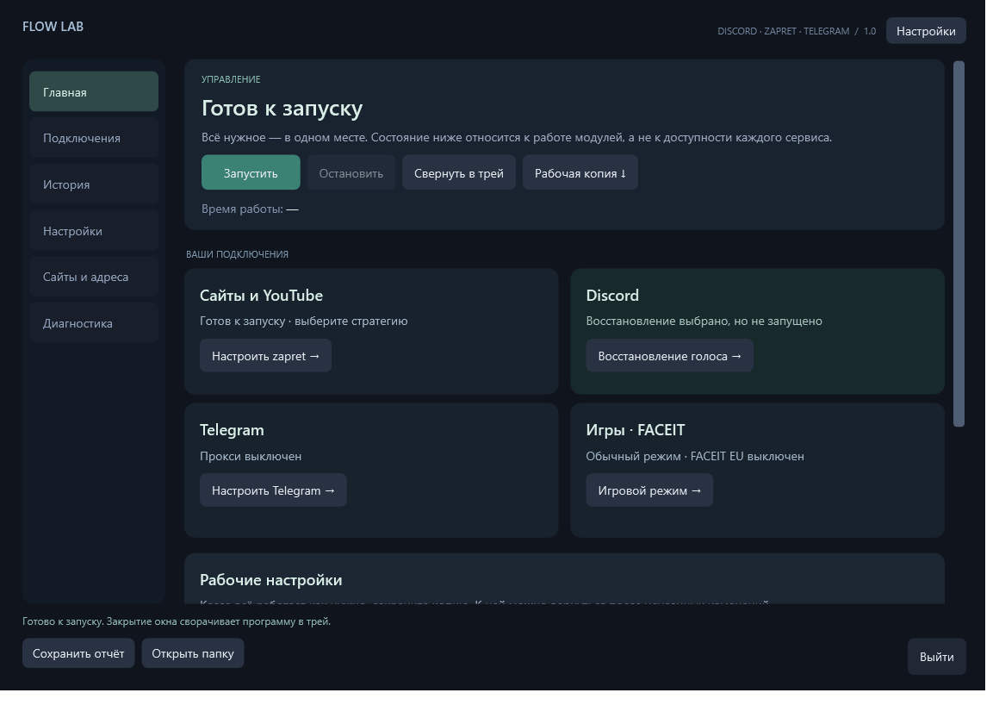
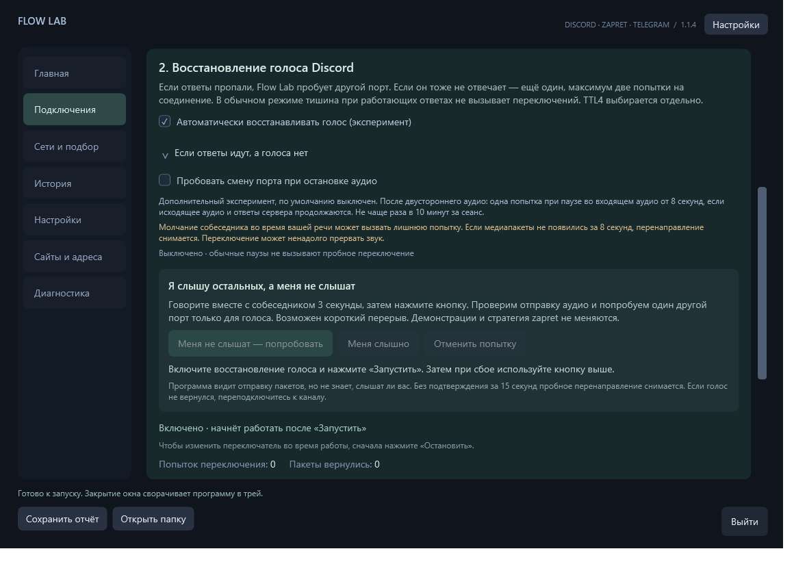
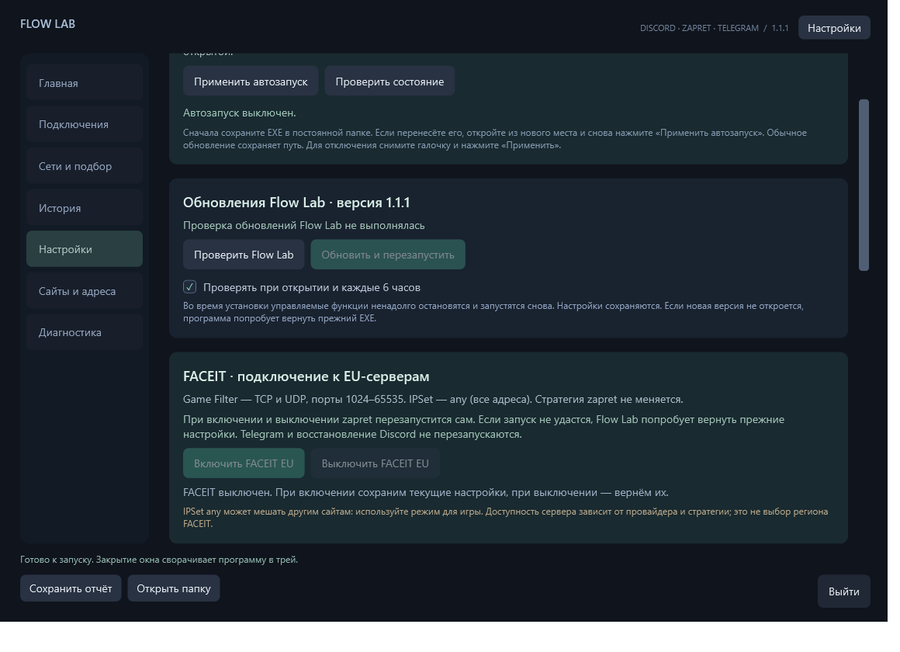
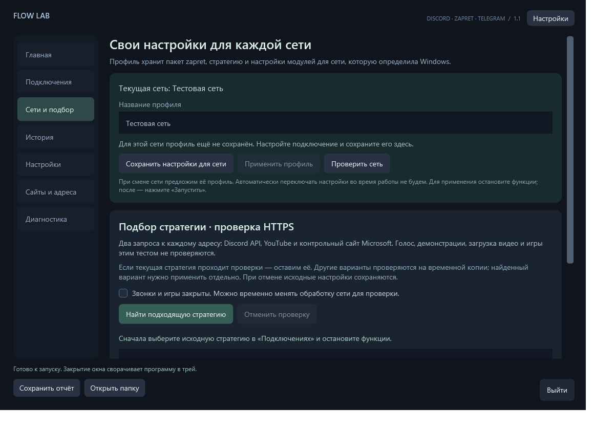

# Flow Lab

Приложение для Windows: zapret, Telegram-прокси и экспериментальное восстановление потоков Discord в одном интерфейсе.

**[Скачать Flow-Lab.exe](https://github.com/krizof/flow-lab/releases/latest/download/Flow-Lab.exe)** · **[Последний выпуск](https://github.com/krizof/flow-lab/releases/latest)**

Windows 10/11 x64, .NET Framework 4.8. Достаточно одного EXE; Python не нужен.

## Начать пользоваться

1. Сохраните EXE в постоянной локальной папке, откройте и подтвердите UAC.
2. В «Подключениях» установите пакет zapret или выберите существующую папку в «Настройках».
3. Выберите рабочую стратегию. **TTL4 — выбор стратегии; восстановление голоса — отдельный переключатель.**
4. Нажмите «Запустить» на главной. Для Telegram отдельно включите прокси в настройках и подтвердите подключение кнопкой «Подключить Telegram».
5. Сворачивание и крестик отправляют окно в трей. «Выйти» завершает программу и её собственные процессы.

Если zapret запущен отдельной службой/батником, Flow Lab его не завершает. Для управления стратегией и FACEIT из приложения сначала остановите внешний экземпляр.

## Меня не слышат · 1.1.4

В «Подключениях» → «Восстановление голоса Discord» появился блок **«Я слышу остальных, а меня не слышат»**. Говорите вместе с собеседником 3 секунды, затем нажмите **«Меня не слышат — попробовать»**. К этому разделу можно перейти и из трея.

Программа проверяет свежую отправку аудио, определяет основной голосовой поток по локальному журналу Discord и делает одну пробную смену порта. Неоднозначный поток, отсутствие свежих данных или недавний обрыв управляющего соединения — причина отказаться от попытки. Новая кнопка не меняет демонстрации, стратегию zapret и игровой режим.

Спросите собеседника, слышно ли вас. Если да — **«Меня слышно»**, иначе — **«Отменить попытку»**. Без подтверждения за 15 секунд перенаправление снимается. Отмена остаётся доступна после подтверждения. Повторная ручная попытка — не чаще раза в 10 минут за сеанс; время ожидания видно в интерфейсе. Это помощь по вашему сообщению о сбое, а не автоматическая проверка слышимости. Возможна короткая пауза; при отсутствии звука после отмены может потребоваться перезаход в канал.

WinDivert теперь подготавливается в защищённой постоянной папке ProgramData. При ошибке пути возможно исправление записи **остановленной** службы; работающий драйвер не останавливается. Защита Windows не отключается. Выбранные файлы копируются без изменения и сверяются.

Проверены настоящие UDP-пакеты на localhost и сценарии отказа, интерфейс и ограничения попыток. Это не проверка живого Discord или фильтра конкретного провайдера. [Подробный отчёт](QA-1.1.4.txt).

## Дополнительное восстановление аудио · 1.1.3

В «Подключениях» → «Восстановление голоса Discord» раскройте **«Если ответы идут, а голоса нет»**. Новый эксперимент **выключен по умолчанию**; его можно включить перед запуском функций. Рабочая стратегия zapret остаётся прежней.

После устойчивого двустороннего аудио программа может один раз попробовать другой порт, если входящее аудио прекратилось минимум на 8 секунд, но исходящее аудио и ответы сервера продолжаются. Не чаще раза в 10 минут за сеанс. Если на новом порту за 8 секунд не появилось достаточного количества аудиопакетов, перенаправление снимается. Снятие не гарантирует мгновенного возврата доставки сервером.

**Это проверка гипотезы:** собеседник мог просто молчать, пока вы говорите. Возможна лишняя попытка и короткая пауза звука. Возврат пакетов записывается отдельно и не выдаётся за доказанное исправление. Проверена механика на локальных UDP-пакетах, результат в сети провайдера пока не подтверждён.

Отчёт дополнен счётчиками последовательностей аудиопакетов: пропуски нумерации, поздние пакеты, дубликаты и смены нумерации. Запись разговора не ведётся. Анализ доступен и без нового экспериментального режима, при включённом обычном восстановлении.

## Обычное восстановление Discord · 1.1.2

Если первый запасной порт перестаёт отвечать, Flow Lab пробует второй при продолжающейся отправке. Максимум две попытки на соединение и четыре за минуту. На работающие служебные ответы и обычную тишину повторное переключение не срабатывает.

История разделяет ответ сервера, появление медиапакетов и причину завершения попытки. Проверена двойная искусственная блокировка настоящих пакетов на localhost. Результат в конкретной сети провайдера этим тестом не гарантируется; первичное обнаружение сбоя не менялось.

## Что нового в 1.1.1

FACEIT: **TCP и UDP 1024–65535 + IPSet any**. Фактические параметры видны в «Подключениях».

Если был включён старый режим только UDP, нажмите **«Перейти на TCP и UDP»**. zapret перезапустится сам, а исходная копия для отключения FACEIT сохранится. Обновление EXE само не меняет сетевой режим. Стратегия zapret остаётся выбранной; стабильность игры зависит и от неё.

В истории Discord видны завершения попыток и повторное исчезновение ответов после возврата пакетов. Алгоритм восстановления не менялся. Занятый файл драйвера при очистке больше не отменяет успешный подбор стратегии.

## Сети и подбор · 1.1

**«Сети и подбор» → «Сохранить настройки для сети»**: независимые профили для домашней сети, телефона и других подключений. Пакет zapret, списки и настройки модулей сохраняются целиком. При возвращении в знакомую сеть профиль предлагается, а применяется только по кнопке после остановки функций. Ключ — идентификаторы подключённых сетей Windows; VPN или сброс сети могут создать отдельный профиль.

**«Найти подходящую стратегию»** сначала проверяет текущую стратегию. Если она проходит, менять её не предлагает. Иначе ищет вариант, прошедший все HTTPS-проверки, и повторно проверяет исходную и кандидата. Частичный или нестабильный результат не применяется.

Для подбора остановите функции Flow Lab и внешний zapret, выключите FACEIT, закройте Discord, CS2, звонки и игры. Стратегии запускаются по одной из временной копии и на время проверки влияют на трафик всего ПК. Исходная папка не меняется; проверку можно отменить. Изменение сети останавливает тест.

**Проверяется HTTPS-доступ к API Discord, короткому ответу YouTube и контрольному сайту Microsoft. Голос, демонстрации, загрузка видео и игры этим не проверяются.** Подбор не диагностирует обрывы голоса при работающем HTTPS.

Результат применяется отдельной кнопкой. «Отменить последнее применение» возвращает настройки до применения профиля/стратегии. Основная рабочая копия на главной остаётся независимой. После применения нажмите «Запустить», проверьте нужные функции и сохраните профиль сети. Журнал текущего сеанса содержит этапы подбора; история — итог.

## Рабочая копия

Когда вы проверили, что нужные сервисы работают: **«Главная» → «Сохранённые настройки ↓» → «Сохранить текущие настройки»**.

Копия включает пакет zapret, стратегию, списки и настройки модулей. Это ваше подтверждение рабочего состояния, а не автоматическая проверка сети.

Возврат: **«Остановить» → «Вернуть рабочие настройки» → «Запустить»**. Файлы проверяются по SHA256 и разворачиваются в отдельную папку, текущая папка сохраняется. Автозапуск Windows, секрет Telegram, сам EXE и внешние программы не меняются. Хранятся две последние сохранённые копии, кнопка возвращает последнюю. Лимит пакета — 96 МБ.

## История событий

Ошибки запуска/модулей, попытки восстановления Discord, возврат RTP-подобных пакетов, ваши отметки и операции с рабочей копией. Последние 500 событий сохраняются локально между запусками. Старые логи версий до 1.0 не импортируются.

**«История» → выбрать событие → «Сохранить отчёт об этом событии»**. ZIP включает выбранную запись и до 20 соседних событий этого сеанса; это не полный захват пакетов. UDP-события появляются при включённом восстановлении Discord. Отсутствие событий не доказывает отсутствие сбоев, возврат пакетов не доказывает слышимость. Аудио не записывается.

## Другие функции

- Полный пакет zapret и обновления из официальных релизов Flowseal.
- FACEIT EU: Game Filter TCP и UDP + IPSet any, автоматический перезапуск своего zapret и возврат прежних параметров.
- Встроенное ядро tg-ws-proxy без второго интерфейса.
- «Сайты и адреса»: обновление официального IPSet, редактор сайтов/исключений, проверка ввода и отмена последней записи. Используются списки, на которые ссылается выбранная стратегия.
- Диагностика, проверка файлов стратегии и экспорт полного журнала текущего сеанса.

## Автозапуск и обновления

«Настройки» → «Автозапуск Windows» → «Запускать Flow Lab при входе в Windows» → «Применить автозапуск». Опция «Сразу запускать выбранные функции» включает сохранённый набор модулей. Запуск в трее через 15 секунд после входа; при ошибке старта окно остаётся открытым. По умолчанию выключен.

После ручного переноса EXE повторно примените автозапуск. Для отключения снимите галочку и нажмите «Применить автозапуск».

Обновление: **«Настройки» → «Проверить Flow Lab» → «Обновить и перезапустить»**. Установка по кнопке, настройки сохраняются. Во время обновления управляемые функции ненадолго останавливаются; при неподтверждённом запуске новой версии предусмотрена попытка отката. Версии до 0.7 нужно один раз заменить вручную.

## Практические ограничения

Состояние процесса не доказывает доступность сервиса. Работа Discord/FACEIT зависит от сети и стратегии. Восстановление голоса остаётся экспериментальным. IPSet any может мешать другим сайтам; после игры режим можно выключить. Регион аккаунта FACEIT и параметры античита не меняются.

Логи автоматически никуда не отправляются. Экспорт может содержать IP-адреса и локальные пути. SHA256 проверяет целостность загрузки; EXE пока не подписан сертификатом Authenticode.

## Источники и публикация

[Flowseal/zapret-discord-youtube](https://github.com/Flowseal/zapret-discord-youtube) · [Flowseal/tg-ws-proxy](https://github.com/Flowseal/tg-ws-proxy) · [Планировщик Windows](https://learn.microsoft.com/en-us/windows/win32/taskschd/logontrigger)

[Как выпустить обновление](PUBLISHING.md). Репозиторий содержит дистрибутивы и инструкции; личные диагностические материалы не публикуются.
